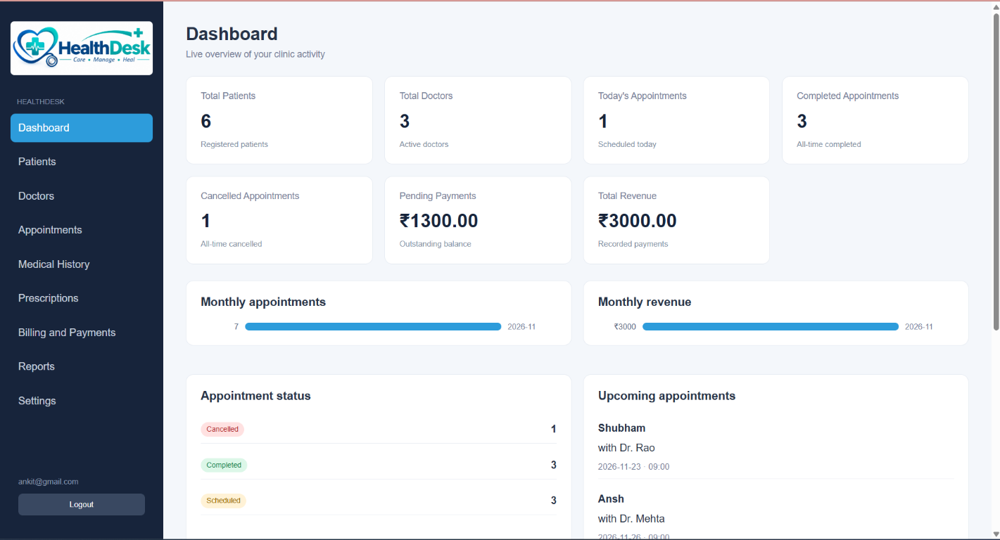
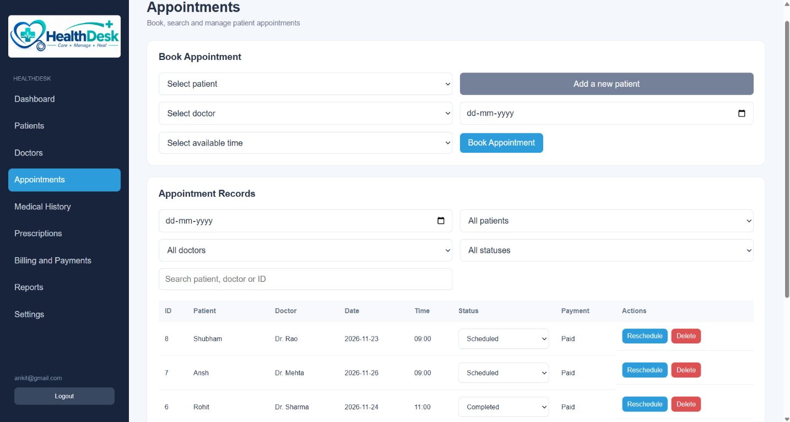
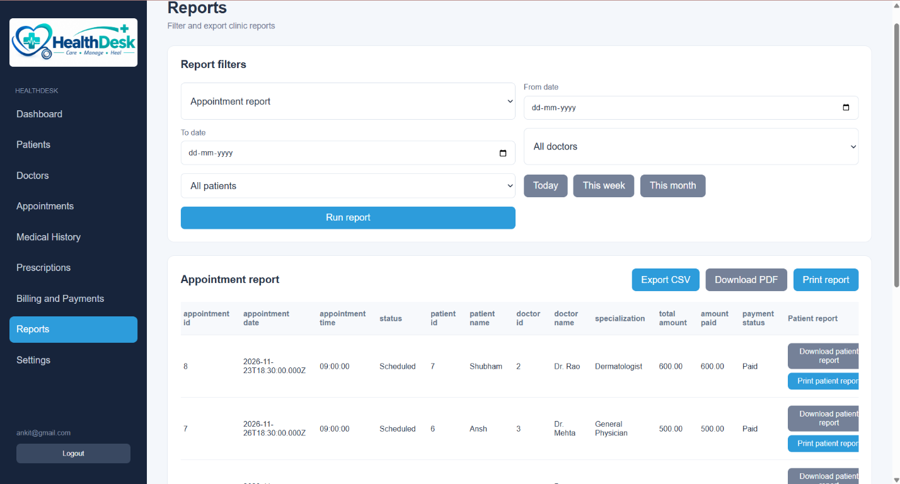
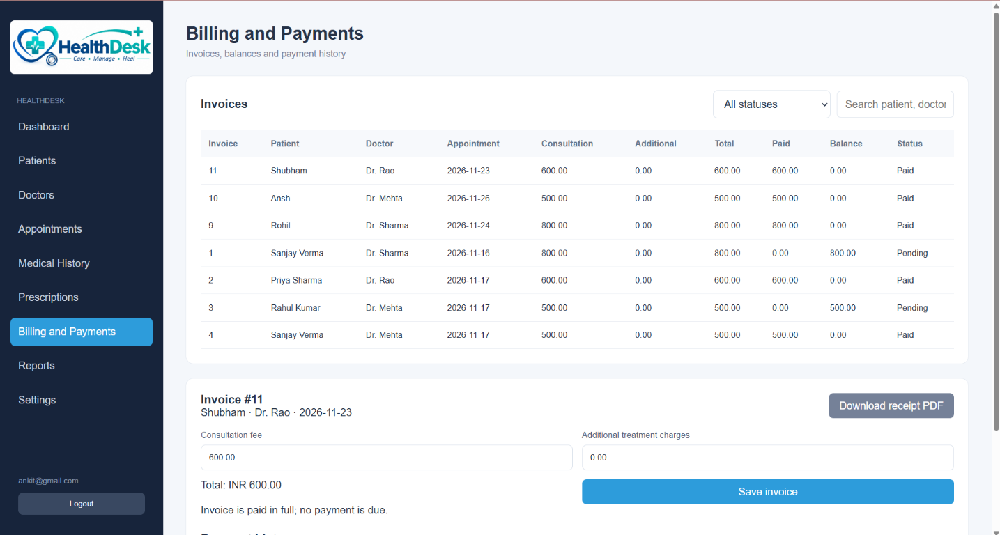
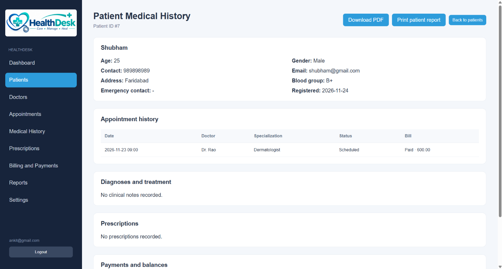
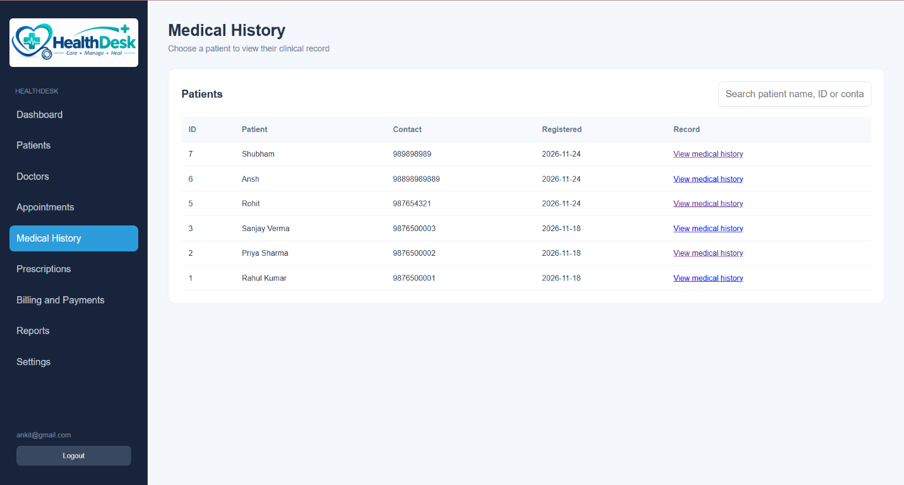
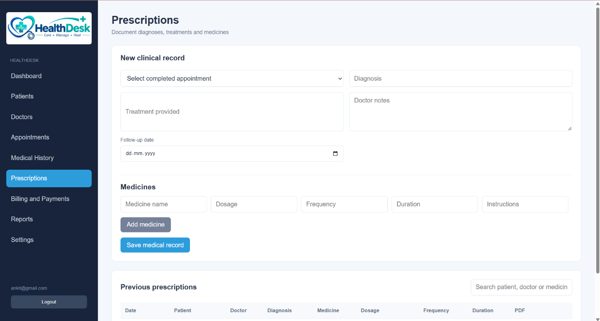
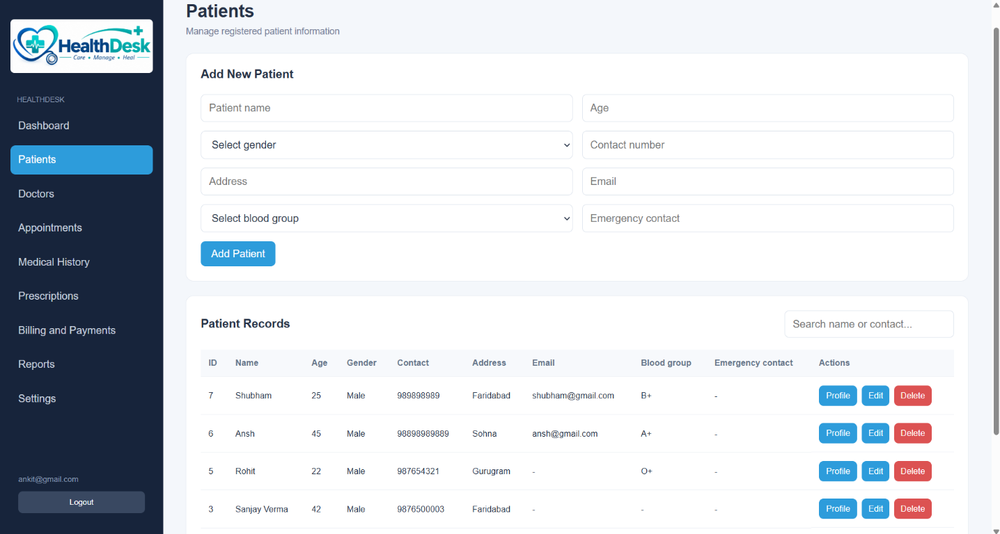
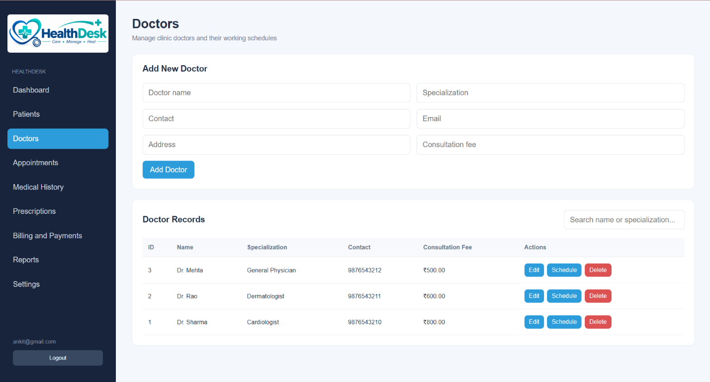

# HealthDesk Clinic Management

HealthDesk is a web app for handling everyday clinic work in one place. An administrator can manage patients and doctors, book appointments, track consultation payments, and view or print patient reports.

The app is built with React and Vite, Node.js and Express, and MySQL.

## What you can do

- View clinic activity, appointments, and payment totals on the dashboard.
- Add and update patient and doctor records.
- Set doctors' weekly working hours and book available appointment slots.
- Record the consultation fee and payment method when booking an appointment.
- View invoices, payment history, and balances.
- Keep diagnoses, treatment notes, follow-up dates, and prescriptions.
- Download or print appointment reports and individual patient medical histories.

## Screenshots

These screenshots show the app using demo data. If any information shown is real patient information, replace it with anonymized data before publishing this README.

### Dashboard



### Appointments



### Reports



### Billing and payments



### Patient profile



### Medical history



### Prescriptions



### Patients



### Doctors



## Run it on your computer

You will need Node.js with npm, MySQL, and a MySQL account that can create and update the `clinic_management` database.

### 1. Install the app dependencies

Open PowerShell in the project folder and run:

```powershell
npm install --prefix .\backend
npm install --prefix .\frontend
```

### 2. Configure the database

Copy the example settings file, then edit the copy with your MySQL username, password, and a private `JWT_SECRET` of at least 32 characters:

```powershell
Copy-Item .\backend\.env.example .\backend\.env
```

Keep `.env` private and do not commit it.

For a **new demo database**, run these scripts in order from the project folder. Replace `root` with your MySQL username if needed:

```powershell
& $env:ComSpec /c 'mysql.exe --user root --password < "database\schema.sql"'
& $env:ComSpec /c 'mysql.exe --user root --password clinic_management < "database\sample_data.sql"'
& $env:ComSpec /c 'mysql.exe --user root --password clinic_management < "database\migration_001_clinic_upgrade.sql"'
```

MySQL will prompt for your password. You can also open the three SQL files in MySQL Workbench and run them in the same order.

If you already have clinic data, **back it up and run only** `database/migration_001_clinic_upgrade.sql`. Do not run `sample_data.sql` against a database that already contains the demo records, or you may add duplicates. The migration adds the features HealthDesk needs without dropping existing tables or records.

### 3. Create the first administrator

From the project folder, run:

```powershell
npm run create-admin --prefix .\backend
```

Enter the admin email and a password of at least 12 characters when prompted. The password is hidden while you type and is stored as a bcrypt hash in the database.

### 4. Start the app

Open two PowerShell terminals in the project folder. Run the backend in one:

```powershell
npm run dev --prefix .\backend
```

Run the frontend in the other:

```powershell
npm run dev --prefix .\frontend
```

Then open [http://localhost:5173](http://localhost:5173) and sign in with the administrator account you created.

## First steps in the app

1. Open **Doctors**, choose **Schedule**, add each doctor's working days and hours, then click **Save schedule**. **Add time range** by itself does not save the schedule.
2. Open **Appointments**, choose a patient, doctor, date, and available time.
3. Select the payment method. The doctor's consultation fee is recorded as paid when the appointment is booked. That fee stays fixed on the invoice if the doctor’s fee is changed later.
4. Open **Reports** to filter appointments. Use **Download PDF**, **Export CSV**, or **Print report** for the selected report. Use the patient report buttons on a row for that patient's medical history.
5. After booking, use the patient report buttons shown on the page to download or print the patient's medical history.

Only an active administrator can access the app's business features. Appointment availability is refreshed while the booking form is open, and the server prevents two appointments from using the same doctor and time.

## API overview

The API runs at `http://localhost:5000`. All routes below require an administrator token except `POST /api/auth/login`.

- `/api/patients` — patient records and medical histories.
- `/api/doctors` — doctor records and weekly availability.
- `/api/appointments` — appointment booking, filters, and time availability.
- `/api/prescriptions` — diagnoses, treatment details, and prescriptions.
- `/api/invoices` — invoices and payment history.
- `/api/dashboard` — clinic totals and upcoming appointments.
- `/api/reports` — appointment, doctor, revenue, and pending-payment reports.

## Checks

Build the frontend with:

```powershell
npm run build --prefix .\frontend
```

Run the frontend linter with:

```powershell
npm run lint --prefix .\frontend
```
